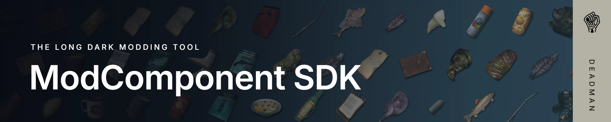

<div align="center">



[](https://github.com/Deaadman/mod-component-sdk/releases/latest) [](https://github.com/Deaadman/mod-component-sdk/releases/tag/nightly) [](LICENSE)

</div>

The ModComponent SDK is a Unity package for making `.modcomponent` item mods for [The Long Dark](https://www.hinterlandgames.com/the-long-dark/). You describe items, blueprints, localization and spawns in the editor, the SDK checks them against what the [ModComponent](https://github.com/dommrogers/ModComponent) loader actually accepts, and builds a ready-to-install `.modcomponent` file.

| | Version |
| --- | --- |
| The Long Dark | 2.58 |
| ModComponent | 7.0.0 |
| Unity | **6000.0.60f1** exactly, the version the game is built with |

## Install

1. Install Unity **6000.0.60f1** from Unity Hub and create a project.
2. In **Window › Package Manager**, choose **+ › Install package from git URL…** and enter:
   ```
   https://github.com/Deaadman/mod-component-sdk.git?path=src#2.0.0
   ```
3. Switch the build target to **Windows** in **File › Build Profiles**.
4. Open **ModComponent SDK › Mod Hub**, then **New › Mod…**, or **ModComponent SDK › Create Example Mod** to start from a working example.
5. Build with **Build…** in the Hub. The first build offers to turn on JSON catalogs, which ModComponent needs, and Unity recompiles once.

When a new release is out, the Mod Hub shows a banner that installs it. To update by hand, enter the git URL again with the new version after the `#`.

### Add-ons

Add-ons are optional packages that teach the SDK about other mods. Install one the same way, with the same version as the SDK, and the update banner keeps it in step:

| Add-on | What it adds | Git URL |
| --- | --- | --- |
| [Item Rarities](addons/item-rarities/Documentation~/index.md) | A rarity per item, written to `rarities.ir` | `https://github.com/Deaadman/mod-component-sdk.git?path=addons/item-rarities#2.0.0` |

### Coming from 1.x

Open **ModComponent SDK › Import 1.x Mods…**, run a dry run, then import. Your 1.x assets are left as they are. After checking the result, remove the old scripts from your prefabs with the button in that window. A validation rule also points out any you missed.

### Nightly builds

Every change is built straight away and published as the [nightly release](https://github.com/Deaadman/mod-component-sdk/releases/tag/nightly). It has the newest fixes and features, but it may be unstable. Back up your project first, then install it with:

```
https://github.com/Deaadman/mod-component-sdk.git?path=src#nightly
```

To have the update banner offer each new nightly, turn on **Include nightlies** in **Preferences › ModComponent SDK**.

## What it does

| Area | What you get |
| --- | --- |
| Mod Hub | One window listing every mod in the project with its items, blueprints and tables, issue counts on each row, and the selected asset's inspector alongside it |
| Items | Each item is a `GearItem` asset with one component and any behaviours, shown as cards with tabs, units and tooltips. Prefabs stay pure visuals, and the build never changes them |
| Pickers | Gear, sounds, scenes, loot tables, liquids, powders, localization keys and prefab children come from searchable lists, and typing a name from another mod still works |
| Validation | Dozens of checks based on the ModComponent source, such as prefab names, missing icons, loader traps and invalid spawn lines, most with a one-click fix. A build won't start while there are errors |
| Builds | Staged in `Library/`, with a temporary Addressables group, and your project's Addressables settings put back afterwards. A build can copy the result straight into the game's `Mods` folder |
| Localization | A spreadsheet view, and CSV import and export for translators |
| Spawns | A coordinate paste box and a preview of the exact file the build writes |
| Icons | An inspect preview to line up the inspect view, and an inventory icon renderer |
| Wizards | **New Mod** and **New Item**, with 14 item templates |
| 1.x importer | Brings mods made with SDK 1.x across without touching the originals |
| Add-ons | Packages that add support for other mods, such as Item Rarities, to every mod, item, build and check |

[The guide](src/Documentation~/index.md) walks through making a mod, and the [wiki](https://github.com/Deaadman/mod-component-sdk/wiki) has the reference pages.

## Bugs and ideas

Found a bug? Use the [bug report form](https://github.com/Deaadman/mod-component-sdk/issues/new?template=bug_report.yml). Have an idea? Use the [feature request form](https://github.com/Deaadman/mod-component-sdk/issues/new?template=feature_request.yml).

Questions and feedback are welcome on the [Discord](https://discord.gg/2mnXAZfGXQ).

## Learn more

- [The guide](src/Documentation~/index.md): making your first mod
- [Wiki](https://github.com/Deaadman/mod-component-sdk/wiki): reference pages
- [Contributing](docs/contributing.md): working on the SDK itself, and releasing it
- [Changelog](CHANGELOG.md)

Older guides written for 1.x and for hand-made ModComponent mods are still useful background, but field names and workflows differ:

- [ModComponent Basic Guide](https://github.com/TLD-Mods/Guides/blob/main/ModComponent%20Basic%20Guide.md) by [Jods-Its](https://github.com/Jods-Its)
- [ModComponent Documentation](https://github.com/dommrogers/ModComponent/blob/master/docs/index.md) by [STBlade](https://github.com/dommrogers)

## License

The ModComponent SDK is licensed under [GPL-3.0](LICENSE).

## Disclaimers

**AI assistance.** Parts of this project, including some of its code, were written with the help of AI coding agents.

**Not affiliated with Hinterland.** The ModComponent SDK is an unofficial fan-made tool. It isn't made, endorsed or supported by Hinterland Studio. The Long Dark and its assets are the property of Hinterland Studio. Please report problems with the SDK here, not to Hinterland.
